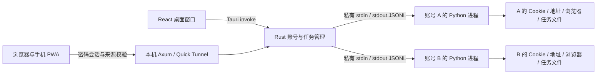

# 架构与运行约定

0.1.17 的按账号凭据缓存、认证后保存、密码拒绝归属和协议优先的统一恢复入口，见 [登录与凭据生命周期](LOGIN-CREDENTIAL-LIFECYCLE.md)。

0.1.16 的每日自动检测窗口、暂停/恢复及与购买队列的边界，见 [每日监控时段](MONITOR-SCHEDULE.md)。

0.1.13 的常驻账号浏览器、统一 App 验证码、活结账准备接手、单店购买目标及七天最早时段，见 [快速自提架构](FAST-PICKUP-ARCHITECTURE.md)；具体交接协议见 [活自提准备接手](PREPARED-HANDOFF.md)。下文历史流程若与该版本专项设计冲突，以专项设计和当前实现为准。

桌面版使用特定 Tauri 命令，本地 Web 使用受保护的 HTTP 接口，两者复用同一任务引擎。手机入口经 HTTPS Quick Tunnel 访问本机服务。界面不提供任意 shell、任意文件访问或远端脚本执行。已有 Python 协议保持可回归，Rust 负责跨平台应用生命周期与隔离；没有为了 Rust 重写 SRP 或猜测 Apple 私有协议。

## 任务协议

每个事件包含 `v: 1`、`account_id`、`task_id`。Rust 不接受账号或任务标识不匹配的事件。

- Rust 首行发送账号、动作和参数。所有路径由 Rust 的应用目录及 UUID 推导；用户不能通过命令参数指定其他账号的目录。
- worker 发出 `stage`、`log`、`prompt`、`result`、`error` 或 `cancelled`。
- `prompt` 包含随机 `id` 与 `kind`：密码、验证码、文本、选项或下单确认。选项使用服务端真实值，确认的响应必须是布尔值。
- 回复带有账号、任务和提示 ID，过期提示或另一账号的输入被拒绝。前端和 Rust 均避免“清理旧提示时抹掉刚到的新提示”的竞态。
- 密码、验证码经内存管道传递，明文不出现在命令行、任务日志或 JSON 文件。应用密码提示和预填密码在当前 Engine 服务进程内按账号缓存，供所有后续单账号任务复用；错误归属或过期提示不会更新缓存。明确的密码拒绝会使缓存失效并暂停旧保险库密码复用，541 / 网络失败不清除缓存。删除保存密码、移除账号及服务退出清除缓存。跨服务重启保存密码时，Windows / macOS 使用系统原生凭据保险库；Linux / Docker 可配置 AES-GCM 加密文件保险库，主密钥独立于数据卷并只读挂载给应用。保存选择随密码代次跨任务传递；只有用户勾选保存、本次实际提交的匹配密码被官网确认认证后才写入，不依赖后续购买结果；不提供明文回退，未配置时仅运行内复用。错误密钥、损坏密文和缺失校验记录均拒绝覆盖；明确密码拒绝只删除与被拒绝值匹配的持久项。浏览器官网直接输入不采集到应用缓存。

worker 可逐步改为 Rust 实现，只需保持动作及事件协议；当前没有必要同时维护两套登录算法。

## 顺序与取消

账号新增记录先带 `pending: true`，只作为未完成添加的草稿。`enroll` 完成原有完整商城登录并通过账户信息查询后，Rust 才将其改为已添加；登录错误、取消和中断不会完成添加。旧账号记录兼容默认 `pending: false`，仍需每次启动时通过用户勾选后的检查。

只有一个已添加账号时，前端直接选用并展示其已有任务，重新打开页面不会在未完成的结账后面追加登录检查。多账号选择继续按用户操作核对；实际购买前由 worker 只读快速核验账号会话，无法核验时使用原浏览器和保存凭据自动恢复；六位验证码在当前任务输入后继续。`me` 复用 Python 的账户页重新认证；查询失败且尚未进入认证时最多补一次完整登录，密码/验证码拒绝不会形成重试循环。完整登录失败时不把原来的内存 Cookie 写回覆盖已清理的认证文件。

认证失败和 541 保留已添加账号、地址及原浏览器资料，worker 不再把任务失败作为自动移除账号的依据。用户可在原账号执行“官网登录恢复（保留账号）”，在官方页面完成验证；显式移除账号仍是独立操作。任务、原始订单证据和账号归属不会因一次登录失败而重新分配 UUID。

`me` 和 `enroll` 返回经过确认的账号信息后，Rust 保存 API 昵称，空昵称回退到邮箱；前端用同一结果同步显示，不额外请求昵称。

每个账号有自己的独占许可，一个账号排队不占用其他账号的执行许可。OTP / 人工确认等待期间保留进程和会话，其他账号继续运行。自动库存队列由单个账号协调器持有此许可，按固定上限派发隔离的门店目标；所有自动队列账号共用 10 个下单子路名额。顺序单路沿用原账号结账，可能重叠的任务使用独立子进程。队列和运行任务均可取消。

自动目标按毫秒时间和序号持久化 FIFO，派发与完成校验账号、任务、队列项和分配代次。已核实的待付款结果不会取消其他已授权门店目标，未知提交会阻止该账号后续自动派发，重启不重放在途购买。详见[执行队列与会话说明](QUEUE-LOGS-SESSION.md)。

关闭应用时发送取消，等待清理，终止应用自己启动的进程。账号浏览器 PID 由 worker 显式报告；不按进程名称批量杀系统 Chrome。系统强制结束整个应用或断电仍可能中断外部操作，已派发购买和定时任务不自动续跑。监控另行持久化运行意图：重启后恢复此前开启的匿名监控，并读取新库存；原队列运行意图、用户暂停、任务取消和提交未知保护共同决定是否可自动派发。见[监控重启恢复](MONITOR-RESTART.md)。

创建订单前记录提交阶段；服务端返回支付链接后先落盘，再获取二维码。请求失败、取消或进程退出都不能证明远端订单未创建，需要用户查询订单。没有自动“恢复旧订单后才允许加购”的额外阻塞流程。

自提前准备使用现有任务输入协议，在同一 Python worker 内保留 Session、Checkout 和本轮官网选店依据，等待明确的下单操作，最多五分钟。等待采用单调时钟截止时间；取消、超时和重启都不会提交订单。触发后重新读取官网；只有新响应能重新确认门店及完整取货联系人身份时才直接继续，否则使用官网提供的编辑操作重新选店或填写联系人，或重新读取购物袋并结账，不重复加购。最终提交前再次核对准备时确认的商品、门店、金额和配置。门店搜索及选择快路径只使用最近一次服务器响应快照，不能用增量合并模型中遗留的门店列表或时段签名代替。

任务快照最多保留 100 条过程记录；完整的有界结构化日志另存 `logs/activity.sqlite`，默认保留 7 天、最多约 10 万条，支持按账号、任务和类别查询。历史中移除二维码 data URL 和支付 URL；原始支付信息只存在相应账号的任务目录。目录和文件写入以原子替换为主，避免中断产生半个 JSON。

## 平台边界

macOS 使用 WKWebView，Windows 使用 WebView2 展示界面；它们不承担 Apple 认证上下文。需要时另启安装好的 Chrome 或 Edge，使用账号私有资料，保留旧脚本的上下文获取行为。

PyInstaller 的单目录包作为 Tauri 资源携带，Rust 使用固定资源路径启动，无系统 Python 依赖。分别在相应平台/架构构建，不能把 macOS 的 Python 二进制放进 Windows 安装包。

## 验证边界

已覆盖离线业务回归、两个 worker 同时写不同账号目录、旧输入丢弃、取消输入等待、错误密码清理、导入 Cookie 校验、明确下单确认，以及 Rust 的排队/取消和 UI 的账号切换。真实账号登录、Apple 服务端 541、库存、配送与真实支付仍需使用者在自己的账号上验证；没有把离线桩结果标注为真实商城成功。

Windows 和 Intel macOS 的构建工作流已配置。只有实际相应 runner / 实机成功后，才能将该平台标记为已验证。

## 构建故障记录

本机 Xcode 27 / Rust 1.97.1 的发布构建曾报 `can't find crate for tauri_macros`。检查宏动态库后得到 `mis-aligned LINKEDIT string pool`，与 Rust/LLVM 剥离调试信息的已知问题一致。`Cargo.toml` 显式关闭 release 和构建依赖的 strip，避免生成无法加载的宏动态库；不是应用业务依赖缺失。上游记录：[rust-lang/rust #157750](https://github.com/rust-lang/rust/issues/157750)。

## 登录前页面和预设

前端使用 Hash 路由 `#/settings` 与 `#/duo`，桌面和 Web 共用。公开任务使用保留的 nil UUID 表示本地工作空间，不进入 Apple 账号目录；Rust 和 worker 都只允许该作用域执行匿名 catalog 和本地 address_read/address_save。任务及模板保存在 `settings/`，不读取其他账号 Cookie，不触发登录。Web 的本机访问令牌和来源校验仍生效。

通用购买预设通过 `save_preset` 写入 `settings/purchase.json`；通用地址写入 `settings/checkout.json`。新增账号创建时复制预设，已有账号不跟随模板变化。账号专用设置仍写自己的目录。DUO 页面复用原 `query_duo` 解析器，SKU 预制数据仅做默认展示和快捷选择，实时失败与未返回 SKU 均不推断库存。

自动会话维护提供预热登录、自提准备和官网登录恢复（`browser_login`）三个流程。它们与保留账号恢复、账号检查、购买前核验共用当前会话和协议优先的恢复入口；需要浏览器时沿用原账号资料与运行模式。后台失败按十分钟空闲节奏再次尝试，维护间隔与旧冷却不阻止购买的即时核验。详细行为、原浏览器资料复用与认证边界见 [官网恢复与空闲会话刷新](STOREFRONT-SESSION-RECOVERY.md)。
