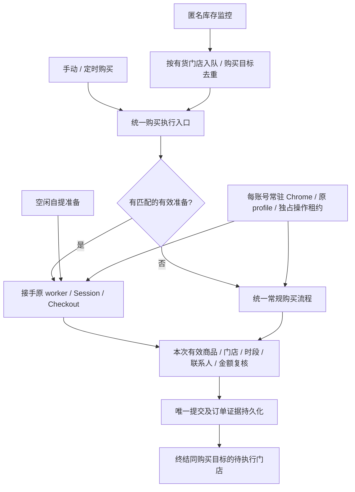

# 常驻账号会话与快速自提架构

0.1.20 更新了准备范围、五分钟租约续期、单店失败后的活 Checkout 续用及账号身份核验，详见 [活结账优化](LIVE-CHECKOUT-PERFORMANCE.md)。下文首版有效期指单次准备租约；续期不恢复历史购买或已失败任务。

状态：0.1.13 已实现，离线回归与合成浏览器验证完成；镜像发布与现场下单效果分别验收，不代表已达到三秒。

## 目标和现场依据

2026-10-24 的购买样本中，21:40 任务总时长约 27 秒，已完成请求累计 23.22 秒：账户、购物袋及登录检查 5.23 秒；结账初始化、认证和读取结账页 10.34 秒；自提方式 1.95 秒；三次门店搜索 5.70 秒。最终无可用库存/时段，未提交订单，因此不是成功下单耗时样本。另一任务在门店搜索超时。账号页登录成功不保证结账认证已准备好。

要缩短库存出现后的路径，提前完成可准备步骤，再交接原会话；不能把缩短超时、重复认证或跳过官网商品/门店/金额核对当作提速。

## 分层职责

### 账号会话

Docker broker 按原账号 profile 持有普通 Chrome 进程，资料继续保存在现有持久卷。任务获取独占操作租约，通过 CDP 操作当前任务页面；归还租约不关闭常驻浏览器。显式关闭、移除账号或宿主退出使用明确清理命令；旧租约不能控制新任务。自动、手动和维护使用同一种浏览器模式与认证助手。桌面后台启动避免抢占用户焦点。

浏览器资料、浏览器运行状态和 HTTP Checkout 是三种不同状态。浏览器 profile 持久化不保证官网永不过期，也不等于结账准备完成。Cookie 核验更新、删除必须一致进入原账号持久文件及当前 HTTP Session；不允许旧快照覆盖。网络观察归属当前受控页面和官方认证 frame，不用上下文中无关旧事件判定当前失败，也不以任意账号页 HTTP 200 抹掉真正拒绝。

### 统一登录与验证码入口

首次账号登录的协议认证和后续官网浏览器恢复可以使用不同的官方认证通道，但产品交互统一：复用本账号保存的凭据，自动完成标准登录；官方要求六位验证码时，通过当前任务的 App 输入提示接收并送入当前受控认证页面。单框和六格验证码均需精确匹配可见官方 frame，不从旧标签页读取或向其发送。仅非标准人工挑战、真实认证拒绝等无法自动完成的情况展示对应原因和页面，不以删除账号重建资料恢复。浏览器自动助手和手动输入继续互斥，未知认证提交不能盲目重发。

购买先复用当前有效会话；健康会话不提交登录凭据。只有没有可用登录态或官网当前明确要求认证时才进入共用恢复。网络超时、SSL 错误、无法识别的响应不能被当作已退出登录。活准备优先在原 Checkout 中复核，若官网明确返回认证入口，则在该 Checkout 完成认证后继续，不重新加购。

### 可接手的结账准备

沿用原任务进程保留 Session、Checkout、当前有效页面及授权范围，通过专用私有准备提示等待接手。首版一次准备仅消费一次；不另建第二套下单实现。准备阶段不提交订单。无货时允许保留官网实际到达的部分准备步骤，不能伪造 Review 就绪。

接手匹配账号、SKU、数量、配送方式、有效配置指纹、授权门店及准备有效期。配置指纹按有效规则规范化，不能因为字段顺序或 override 来源不同而错失复用，也不能忽略真实购买范围变化。手动、定时和队列都在同一入口原子认领：成功接手后原准备任务成为购买任务，不再可被后台维护抢占；失败匹配则准备让路，走统一普通执行器。

队列接手保留 queue_job_id、assignment、购买 group 和任务归属；迟到或重复 ACK 不得完成新分配。定时任务保留触发记录与实际执行任务关联，不将交接伪报为订单成功。准备到期安排安全重新准备，避免五分钟准备有效期与十分钟空闲周期造成固定空窗；重新准备不得成为重复加购或认证循环。重启不恢复活 Checkout、不重放在途购买。

### 单店任务与一次购买目标

原 priority 候选门店池拆成每门店独立任务，同属一个购买目标 UUID。先发现有货者先入队，同批按用户优先级；每个任务只尝试本店。同账号串行修改购物袋，不同账号可并行。原本独立授权的 fixed 目标保留独立含义，不静默合并。

一个目标成功创建订单或进入已确认待付款后，结束同组尚未执行任务；提交未知阻止继续其他门店并先核实。成功目标不会因下一次无货/有货轮询重建；显式重新授权或新的购买目标才开启新一轮。历史失败、手动取消和旧在途任务不因迁移复活。入队后的样本年龄、无货或未知不新增派发门槛；撤销授权、范围变化、取消和未知提交保护仍生效。

### 最近七天最早时段

统一手动、定时、监控及准备：以 Asia/Shanghai 的今天为第 1 天，窗口为今天零点至第 7 天结束（第 7 天之后零点不包含）。在官网当前门店及 SKU 返回的有效可预约日期/时段中，剔除过去日期和已结束时段，选择最早开始时刻。支持明天及后续日期；今天无时段不等于未来七天不可预约。

保留官网原日期值、SlotId、signKey 等签名，不能将某日签名移用到另一日或门店。无足够日期证据时不能猜日期。旧 latest/window 设置读入兼容并规范为新的统一 earliest 策略；不再在不同入口执行不同时间规则。新时段 payload 为 `{mode: "earliest", fallback: "earliest"}`，七天为执行层统一语义。

## 性能口径

记录并关联库存发现、入队、派发、worker 开始、准备命中/接手、复核开始/完成、提交请求发出和官网订单确认。耗时使用单调时钟；展示跨任务关联的墙钟时间。分别报告冷启动、部分准备、Review 已就绪三类，不把预热开始时间计入库存触发后的耗时。

三秒目标首先针对有效准备下“库存发现至提交请求发出”；“库存发现至收到订单号”另外统计官网处理耗时。真实库存可能只允许提前准备至 Fulfillment，不能承诺这种路径也始终三秒。减少当前响应已覆盖的重复搜索，不能复用旧门店列表或跨店签名。

## 验收与发布

- 常驻浏览器跨任务复用、租约隔离、取消归还、移除账号清理、broker 重启资料保留及 CDP 重连。
- 自动与手动认证同结果；密码拒绝、验证码、真实限制及网络失败分开；禁止盲目重发认证和未知提交。
- 手动/定时/队列接手保持相同 worker 与 Session；部分准备、过期、配置变化、取消和提交未知路径覆盖。
- 三店同时有货只产生同一购买目标；成功止单、失败按既有规则下一店、重启不重放，旧 fixed 授权保持。
- 今天、明天、第七天、第八天、跨午夜、已结束时段、异店签名均有回归；手机界面展示统一规则。
- README/AGENTS/版本同步，定向及相关完整回归、双架构镜像检查、G3P 在途购买保护与升级后数据核对。

本地合成测试与容器验收不等同真实 Apple 下单。此前真实准备脚本曾被自动审批拒绝；不得换工具绕过该拒绝。现场效果由获准的验证及用户实际购买日志确认。
